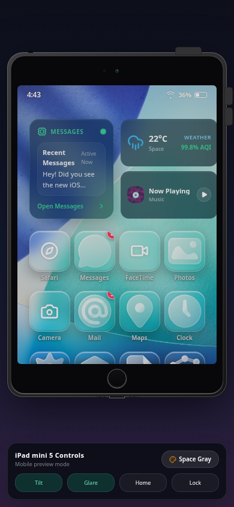

👀 **Buggy and unstable**

<div align="center">
  
  <h1>iPad mini 5 · iPadOS 26 Simulator</h1>
  <p><strong>A polished, interactive iPad mini 5 experience for the browser.</strong></p>
  <p>
    <a href="https://github.com/Quincunx33/ipad-simulation">Repository</a>
    ·
    <a href="https://ipad-simulation.pages.dev">Live Demo</a>
  </p>
</div>

## Overview

This project recreates an iPad mini 5-style device in a responsive browser interface. It combines a physical device frame, iPadOS-inspired Home Screen, widgets, Liquid Glass-style app icons, interactive hardware controls, app launch surfaces, Control Center, and a compact mobile control sheet.

The experience is designed to feel natural on desktop, tablet, and phone screens. On wide displays, the simulator is presented alongside a full customization panel. On narrow screens, the controls collapse into a mobile-friendly bottom sheet while the device remains visible and usable.

> This is an independent browser simulation inspired by iPadOS visual language. It is not an Apple product and does not reproduce Apple proprietary software.

## Highlights

| Area | Included |
| --- | --- |
| Device | iPad mini 5-style portrait frame with Space Gray, Silver, and Gold finishes |
| Home Screen | iPadOS-inspired wallpaper, widgets, app grid, labels, badges, and dock |
| Interaction | Power, side, volume, Home, lock, tilt, glare, and Control Center interactions |
| Apps | Settings, Messages, Photos, Mail, Maps, Clock, Weather, Notes, Stocks, Files, Music, and fallback app surfaces |
| Responsive UI | Desktop/tablet customization panel plus a dedicated compact mobile control sheet |
| Visual system | Glassmorphism, subtle gradients, inset highlights, shadows, and responsive safe areas |

## Live Demo

Open the hosted build here: **[iPad mini 5 Simulator on Cloudflare Pages](https://ipad-simulation.pages.dev)**

## Preview


The preview demonstrates the phone layout with the iPad device, status bar, Home Screen widgets, app grid, and compact controls visible together.

## Run Locally

The app is a Vite-powered React and TypeScript project.

```bash
git clone https://github.com/Quincunx33/ipad-simulation.git
cd ipad-simulation/app
npm install
npm run dev
```

For a production build:

```bash
npm run build
npm run preview
```

## Project Structure

| Path | Purpose |
| --- | --- |
| `app/src/components/ipad/` | Device frame, boot sequence, Home Screen, and iPad surface logic |
| `app/src/components/system/` | Status bar, Control Center, app icons, and shared system UI |
| `app/src/components/apps/` | Interactive app screens and fallback app surface |
| `app/public/assets/` | Small runtime assets such as the iPadOS-inspired wallpaper |
| `docs/` | Project documentation and preview media |

## Design Notes

The interface uses a dark studio background to keep the device readable, a restrained translucent glass treatment for controls, and responsive spacing that reserves room for the status bar and mobile controls. App surfaces are intentionally lightweight so the simulator remains fast and easy to extend.

## Technology

React · TypeScript · Vite · Tailwind CSS · Framer Motion · Lucide React · Icons8 Liquid Glass React components

## License

This project is released under the MIT License. Third-party assets remain subject to their original licenses. See `docs/icon_sources.md` for the online icon and UI-kit source notes.

## References

- [Apple Design Resources](https://developer.apple.com/design/resources/)
- [Apple iPadOS 26 announcement](https://www.apple.com/newsroom/2025/06/ipados-26-introduces-powerful-new-features-that-push-ipad-even-further/)
- [Icons8 Liquid Glass Icons](https://github.com/icons8/liquid-glass-icons)
